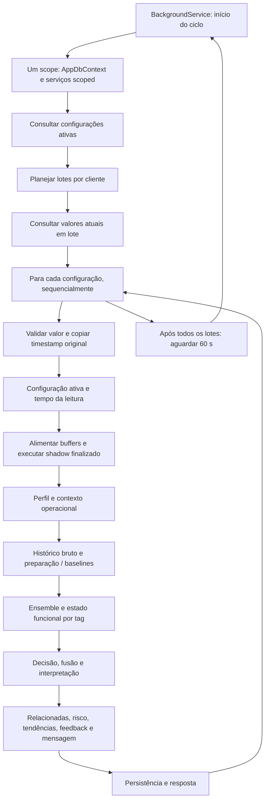
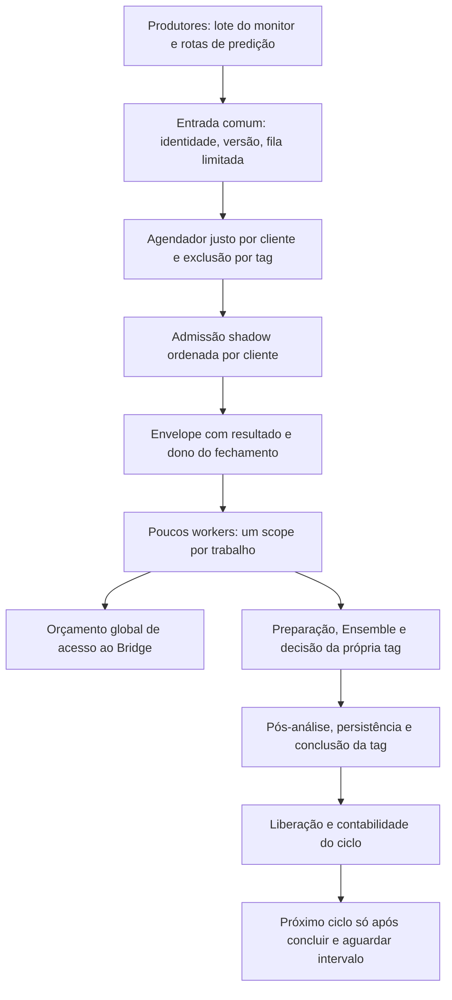

# Auditoria arquitetural de concorrência e sincronização temporal — IAApi

Data: 05/11/2026. Escopo: código local atual, incluindo alterações ainda não commitadas das etapas anteriores. Entrega exclusivamente documental.

## 1. Resumo executivo

**A arquitetura atual exige preparações anteriores à concorrência controlada. Não é seguro paralelizar o foreach do monitoramento.** O sistema tem componentes que favorecem uma evolução incremental — escopos DI, estado funcional protegido por tag, operações de buffer com locks locais, modelos separados de inferência e instrumentação —, mas essas proteções não formam uma garantia de processamento concorrente do pipeline completo.

Os bloqueadores principais são:

1. **Um único AppDbContext por ciclo de monitoramento.** As tags usam as mesmas instâncias scoped. Operações paralelas nesse escopo violariam o contrato do EF Core. É necessário um escopo e um contexto por predição em voo.
2. **O ciclo de vida dos buffers multivariados não é atômico.** Ler um buffer, verificar a rodada, removê-lo e adicionar uma leitura são operações separadas. Os locks existentes protegem cada buffer, não toda essa sequência nem suas gerações.
3. **Ordem de chegada influencia o estado e a associação multivariada.** Um lock por tag não ordena timestamps. O resultado Mahalanobis é devolvido à chamada que fechou o vetor, e a fusão usa apenas os resultados dessa chamada. Mudar a ordem pode mudar qual decisão recebe a evidência.
4. **O contrato temporal da origem está incompleto.** Há DateTime sem fuso; os minutos multivariados são calculados por Ticks, sem normalização de timezone. Não se deve converter Unspecified para UTC por suposição.
5. **Não existe um orçamento global de acesso ao Bridge.** Há chamadas bloqueantes, requisições adicionais de regime/relacionadas e consultas do LiveMonitor. A capacidade segura do Bridge/PowerServer não pode ser inferida do suporte a requisições simultâneas do HttpClient.
6. **Estado funcional e persistência não são uma transação única.** Uma falha depois de avançar o estado, ou um retry ingênuo, pode repetir efeitos. Contextos separados não resolvem ordenação, idempotência ou contenção de escrita no SQLite.

Recomendação: preparar uma entrada coordenada por cliente, ordenação por tag, admissão multivariada determinística, fila limitada, orçamento de I/O e escopo próprio por trabalho. Só depois ensaiar concorrência entre tags diferentes, com o caminho sequencial como referência e rollback. Não alterar as regras multivariadas para obter velocidade.

### Método e limites da auditoria

- **Confirmado:** propriedade diretamente identificada no código; não significa que um incidente já tenha ocorrido em campo.
- **Risco potencial:** interleaving ou combinação que o código permite; não foi reproduzido em teste de corrida nesta etapa.
- **Dependente de campo:** capacidade, fuso, atomicidade do lote, limites e comportamento do Bridge/PowerServer/CP300 não demonstrados pelo repositório.
- Os tempos de 2,8–5,9 s/tag, 12 tags e grupo PK2 foram fornecidos no pedido. Não foram reproduzidos nem tratados como distribuição estatística de latência.
- Não foram executadas predições, testes de carga, consultas ao banco ou ao CP300, migrações, treinamento ou alterações de configuração. Não houve build nesta auditoria. Os resultados de testes das etapas anteriores não provam segurança concorrente.
- As referências `arquivo:linha` correspondem ao conteúdo local nesta data; não apenas ao HEAD do Git. A lista de evidências ao final detalha métodos e intervalos.

## 2. Mapa do fluxo atual e auditoria do monitoramento

### 2.1 Sequência, escopos e pontos de bloqueio

| Etapa | Comportamento confirmado | Evidência |
| --- | --- | --- |
| Escopo do ciclo | CreateScope acontece antes da consulta das tags e dos dois foreachs. Contexto, CurrentValuePredictionService e BridgeValorAtualService são resolvidos uma vez no ciclo. | `Services/MonitoramentoTagsService.cs:30–45`, `ExecuteAsync` |
| Planejamento | Agrupa cliente por comparação ordinal; deduplica nomes da aquisição sem deduplicar as configurações a analisar. Não ordena tags por timestamp nem por pertencimento a grupo. | `Services/Monitoring/MonitoramentoTagsBatchPlanner.cs:16–31`, `CriarLotes` |
| Aquisição | Um POST de valores atuais por lote de cliente; respostas repetidas por tag ficam com First. Clientes são processados um após o outro. | `Services/MonitoramentoTagsService.cs:45–63`; `Services/BridgeValorAtualService.cs:17–59` |
| Despacho | Cada tag é aguardada até completar. Ausência de valor falha na validação; não dispara outra coleta no caminho em lote. | `Services/MonitoramentoTagsService.cs:90–128`; `Services/CurrentValuePredictionService.cs:51–89` |
| Início da predição | Valida configuração, usa request.DataHora ou DateTime.Now se ausente e executa shadow antes do histórico e do Ensemble. | `Services/PredictionService.cs:77–188` |
| Preparação | BuscarHistorico é síncrono. Regime pode fazer outra consulta por período; memória comportamental faz leitura EF assíncrona. | `Services/AnomalyDetection/Orchestration/PredictionDetectionPreparationService.cs:50–99,149–230`; `Services/AnomalyDetection/OperationalRegimeBaselineProvider.cs:213–272` |
| Decisão | Ensemble e contexto funcional são síncronos; fusão/readiness e interpretação podem aguardar I/O. | `Services/AnomalyDetection/Orchestration/PredictionDecisionOrchestrationService.cs:65–147` |
| Pós-análise | Relacionadas pode consultar valores atuais de outras tags. Tendência de valor consulta histórico novamente, salvo reutilização experimental aplicável. | `Services/AnaliseRelacionadasService.cs:24–44`; `Services/TendenciaValorService.cs:24–64` |
| Finalização | Registrar executa SaveChanges síncrono e monta a resposta. Sem token de cancelamento nesse trecho. | `Services/AnomalyDetection/Orchestration/PredictionFinalizationService.cs:28–82`; `Services/AnomaliaHistoricoService.cs:88–123` |
| Intervalo | Aguarda um minuto depois do trabalho completo, não um minuto entre inícios de ciclos. | `Services/MonitoramentoTagsService.cs:165–171` |

Ser `async` não garante que uma operação seja não bloqueante: o Bridge histórico usa GetAsync(...).GetAwaiter().GetResult e a leitura da resposta também bloqueia (`Services/BridgeHistoricoService.cs:210–239`). O Isolation Forest bloqueia no semáforo de carregamento e espera leitura de modelo de forma síncrona (`Services/AnomalyDetection/IsolationForestDetector.cs:456–500`). Muitas leituras EF são síncronas. Além disso, o provedor Microsoft.Data.Sqlite executa métodos ADO.NET assíncronos de modo síncrono; não se pode deduzir paralelismo efetivo apenas dos awaits. [Limitações assíncronas do provedor](https://learn.microsoft.com/en-us/dotnet/standard/data/sqlite/async).

Uma futura seleção de delegates async sobre as tags pode executar uma longa parte síncrona da primeira predição antes de devolver controle. Será necessário escolher explicitamente entre migração de I/O para async real e uma transição com poucos workers fixos para chamadas bloqueantes; não criar uma tarefa/thread ilimitada por tag.

### 2.2 Sobreposição e valores envelhecidos

**Não há sobreposição entre ciclos desta mesma instância de ExecuteAsync:** ela aguarda cada predição e depois o Delay. **Isso não é exclusão global:** POSTs de predição, outra instância da aplicação ou outro produtor podem analisar a mesma tag ao mesmo tempo. As rotas chamam os serviços diretamente e não participam de uma fila por tag (`Controllers/AnomaliaController.cs:29–69`). Não foi encontrada coordenação distribuída nesse caminho.

**Sim, valores coletados no início podem ser analisados minutos depois.** O dicionário valoresPorTag é mantido durante o lote e o timestamp é copiado sem teste de idade (`MonitoramentoTagsService.cs:49–63,106–112`; `CurrentValuePredictionService.cs:71–85`). Não há prazo de validade operacional antes da predição. O diagnóstico mede a idade somente para UTC confiável; ele não descarta leituras (`Services/Diagnostics/PerformanceDiagnostics.cs:130–145`).

Para uma tag na posição k, a espera após a aquisição é aproximadamente a soma das predições anteriores do lote. Com os intervalos fornecidos, 11 tags anteriores representam aproximadamente **30,8–64,9 s**, sem incluir idade prévia da leitura e coleta. A soma das 12 predições ficaria entre **33,6–70,8 s**, apenas como envelope aritmético, não como medição de um ciclo. O intervalo entre inícios ainda soma coleta, demais custos e 60 s. Um histórico pode consumir até o timeout de 60 s por chamada; com caudas de latência/falhas repetidas, a espera de tags posteriores pode chegar a vários minutos. Não existe deadline global de ciclo que impeça isso.

Outro cliente aguarda o lote e as predições do cliente anterior; o planejamento oferece separação lógica de lotes, não garantia de justiça de atendimento. A ordem original de TagsIaConfig também não tem OrderBy explícito (`MonitoramentoTagsService.cs:39–45`). Uma ordem canônica futura precisa ser caracterizada contra a ordem efetiva dos ensaios, pois a atual não é um contrato estável de SQL.

### 2.3 Número de chamadas não equivale a número de tags

Uma predição bem-sucedida simples tem uma aquisição inicial de histórico e, no modo original, outra para tendência. O experimento aplicável remove somente a segunda. Podem existir consultas adicionais de regime e relacionadas, além da coleta em lote do monitoramento. Treinamento, controllers de histórico e LiveMonitor competem pelo mesmo servidor. Não há semáforo de orçamento do Bridge nesses serviços. Evidências: `PredictionDetectionPreparationService.cs:58,155`; `OperationalRegimeBaselineProvider.cs:235–249`; `TendenciaValorService.cs:30–56`; `AnaliseRelacionadasService.cs:43–44`; `tools/IAApi.LiveMonitor/server/proxy.ts:25–37`.

## 3. Inventário DI e dependências compartilhadas

Os lifetimes abaixo são os registros da aplicação; overrides por `registerExternalServices` ou implantação externa precisam ser conferidos separadamente (`Services/DependencyInjection/IAApiApplicationServiceCollectionExtensions.cs:26,91–93`). Não foi necessário resolver serviços nem conectar ao banco para esta inspeção.

| Serviços | Lifetime / estado relevante | Registro e evidência |
| --- | --- | --- |
| MonitoramentoTagsService | Hosted service, instância única por host; mantém scope apenas no corpo de cada ciclo. | `Services/DependencyInjection/IAApiApplicationServiceCollectionExtensions.cs:57`; `Services/MonitoramentoTagsService.cs:9–30` |
| AppDbContext | Scoped por padrão, SQLite `Data Source=ia_config.db`. Compartilhado por todos os serviços scoped do mesmo scope. | `Services/DependencyInjection/IAApiApplicationServiceCollectionExtensions.cs:28–29` |
| PredictionService, CurrentValuePredictionService | Scoped. Não criar paralelismo reutilizando as instâncias resolvidas no scope do ciclo. | Mesmo arquivo, `:47–48` |
| IHistoricoService → BridgeHistoricoService | Singleton; um HttpClient compartilhado, configuração e metadados diagnósticos. Sem DbContext. | `Services/DependencyInjection/BridgeServiceCollectionExtensions.cs:10–12`; `Services/BridgeHistoricoService.cs:14–34` |
| BridgeValorAtualService, BridgeTagsService | Scoped. BridgeValorAtualService cria seu próprio HttpClient e não implementa IDisposable. Scope por tag multiplicaria clientes/pools sem corrigir seu ciclo de vida. | Registro anterior, `:14–15`; `Services/BridgeValorAtualService.cs:8–13` |
| PredictionContextLoader, ProcessoAnaliseService e serviços de processo | Scoped, várias consultas EF. | `Services/DependencyInjection/ProcessIntelligenceServiceCollectionExtensions.cs:11–17`; `Services/AnomalyDetection/Orchestration/PredictionContextLoader.cs:5–65` |
| Preparation / regime resolver / baseline provider / estatísticas / limpeza | Scoped. Dados de trabalho locais; provider consulta DbContext e Bridge. | `Services/AnomalyDetection/DependencyInjection/AnomalyDetectionServiceCollectionExtensions.cs:42–56`; `Services/DependencyInjection/TagProfileStatisticsServiceCollectionExtensions.cs:10–11` |
| BehaviorRuntimeBaselineProvider, reconciliação e componentes de memória | TryAddScoped. O runtime usa memória persistida em modo de leitura; workflows administrativos distintos podem escrever. | `Services/AnomalyDetection/BehaviorProfiles/BehaviorProfilesServiceCollectionExtensions.cs:28–68` |
| EnsembleDetectionService e seis detectores estatísticos | Scoped. Ensemble mantém contadores/arrays mutáveis por instância. Detectores recebem opções e calculam sobre o input. | `Services/AnomalyDetection/DependencyInjection/LegacyAnomalyDetectionServiceCollectionExtensions.cs:12–49` |
| IsolationForestDetector e feature extractor | Scoped, mas os caches de modelos/ausência e locks são static e compartilhados entre scopes. | `Services/AnomalyDetection/DependencyInjection/IsolationForestServiceCollectionExtensions.cs:23–28`; `Services/AnomalyDetection/IsolationForestDetector.cs:37–59` |
| IsolationForestPersistenceService | Singleton; caminhos e I/O de snapshots. | Mesmo registro, `:30–31`; `Services/AnomalyDetection/IsolationForestPersistenceService.cs:76–97` |
| TagBehaviorProfileResolver, DetectorApplicabilityPolicy | Singleton; não identifiquei estado mutável de execução nesses componentes. Input contém caches locais lazy e não deve ser compartilhado entre predições. | `AnomalyDetectionServiceCollectionExtensions.cs:33–37`; `src/IAApi.Engine/Detection/Input/DetectorInput.cs:5–13,60–94` |
| RuntimeFunctionalDecisionStateStore, RuntimeFunctionalDecisionContextProvider | Singleton. Dicionário por cliente/tag e Gate no valor; histórico funcional/incidente/episódios sobrevivem aos scopes. | `DependencyInjection/Runtime/RuntimeAnomalyDecisionServiceCollectionExtensions.cs:29–33`; `Services/AnomalyDetection/Runtime/RuntimeFunctionalDecisionStateStore.cs:16–69` |
| RuntimeAnomalyDecisionResolver, candidate factory, PredictionRuntimeDecisionService | Singleton. Composição de decisão e métricas; estado funcional fica no store anterior. | Mesmo registro, `:23–36`; `src/IAApi.Application/Runtime/Decision/PredictionRuntimeDecisionService.cs:40–60` |
| RuntimeDecisionMetrics | Singleton; Interlocked e ConcurrentDictionary protegem contagens, mas snapshot de vários contadores não é uma transação global. | `DependencyInjection/Runtime/RuntimeRolloutServiceCollectionExtensions.cs:15–16`; `src/IAApi.Application/Runtime/Observability/RuntimeDecisionMetrics.cs:31–112` |
| DecisionOrchestration, PostDecisionAnalysis, Finalization, ResponseBuilder e mapper | Scoped; não são fronteira independente do DbContext. | `Services/DependencyInjection/AnomalyContextAnalysisServiceCollectionExtensions.cs:12–20` |
| Relacionadas, histórico de anomalias, feedbacks e contexto da tag | Scoped; compartilham EF no scope da predição/ciclo atual. | Registro anterior, `:12–15`; `IAApiApplicationServiceCollectionExtensions.cs:102` |
| TendenciaRisco / TendenciaValor / análises de risco e tendência | Scoped. Risco consulta persistência da própria tag; valor usa histórico original ou snapshot local da mesma predição. | `Services/DependencyInjection/RiskAnalysisServiceCollectionExtensions.cs:11–16` |
| GrupoAnaliseService, IGrupoAnaliseProvider → DatabaseGrupoAnaliseProvider | Scoped no caminho normal. Provider JSON é uma alternativa de benchmark. | `Services/AnomalyDetection/Multivariate/DependencyInjection/MultivariateServiceCollectionExtensions.cs:11,84–100` |
| MultivariateGroupBufferService | Scoped, com caches de configuração e semáforo de carregamento por instância. Esses locks não são uma exclusão compartilhada do store. | Mesmo arquivo, `:14`; `Services/AnomalyDetection/Multivariate/MultivariateGroupBufferService.cs:20–31,479–553` |
| MultivariateRuntimeStateStore | Singleton; buffers e último minuto por cliente. Deve continuar compartilhado para formar vetores entre scopes. | Registro multivariado, `:16`; `MultivariateRuntimeStateStore.cs:14–18` |
| MultivariateModelPersistenceService | Singleton; cache concorrente, modelos com listas mutáveis publicados por referência. | Registro multivariado, `:17`; `MultivariateModelPersistenceService.cs:13–16,43–83` |
| MultivariateDetector, ShadowRuntimeCoordinator, CounterfactualObserver, PredictionMultivariateDecisionService | Scoped. Detector trabalha com cópia finalizada e modelo compartilhado; coordinator não é dono exclusivo dos buffers. | Registro multivariado, `:53,62–63,75–79` |
| CounterfactualEvaluator, FusionResolver, OperationalInterpretationFactory | Singleton; avaliação sobre argumentos, sem buffer próprio. Readiness service é scoped e lê EF; evaluators de readiness/qualificação são singleton. | Registro multivariado, `:25–44,59–73` |
| Serviços de interpretação e IAnomalyInterpretationService | Scoped; implementação rule-based ou LLM escolhida por configuração. Se LLM habilitado, há outro backend cuja capacidade precisa de orçamento próprio. | `Services/AnomalyDetection/Interpretation/DependencyInjection/AnomalyInterpretationServiceCollectionExtensions.cs:12–41`; `LocalLlmAnomalyInterpretationService.cs:10–34` |
| ILlmProvider → LmStudioLlmProvider / infraestrutura HttpClientFactory | Typed client registrado por AddHttpClient; transient, com handler gerenciado pela fábrica e timeout configurado. Deve permanecer de vida curta e sem captura em novo singleton de trabalho. | `DependencyInjection/Llm/LlmServiceCollectionExtensions.cs:12–36`; `Services/DependencyInjection/IAApiApplicationServiceCollectionExtensions.cs:98` |
| PerformanceDiagnostics e PredictionHistoryReuseOptions | Singleton. Diagnóstico usa AsyncLocal de metadados; opção imutável. Snapshot bruto é local e não é cache global. | `IAApiApplicationServiceCollectionExtensions.cs:31–39`; `Services/Diagnostics/PerformanceDiagnostics.cs:11–12`; `PredictionRawHistorySnapshot.cs:9–37` |
| IntelligenceLab collectors, buffer e health | Singleton opcionais. Buffer limitado usa lock; a captura por análise é separada. | `Services/DependencyInjection/IntelligenceLabServiceCollectionExtensions.cs:50–55`; `src/IAApi.Infrastructure/Observability/BoundedDiagnosticBuffer.cs:12–16,102–160` |
| Read model experimental de incidentes e query service | Singleton, separado do estado funcional online. Store tem Dictionary sem lock; carga rastreada ocorre antes de app.Run. Risco se houver atualização concorrente futura, não prova de corrida atual de predição. | `DependencyInjection/ExperimentalIncidents/ExperimentalIncidentServiceCollectionExtensions.cs:39–48`; `Program.cs:31–46`; `src/IAApi.Infrastructure/Incidents/Experimental/ReadModels/InMemoryIncidentReadModelStore.cs:7–18` |
| RuntimeRolloutSnapshotHostedService | Outro hosted service, com scopes próprios; pode acrescentar escrita/leituras no mesmo SQLite se habilitado. | `DependencyInjection/Runtime/RuntimeRolloutServiceCollectionExtensions.cs:63–78`; `Hosting/Runtime/Rollout/RuntimeRolloutSnapshotHostedService.cs:30–60` |

O transient identificado é o typed client LLM criado por AddHttpClient; os serviços principais de predição e detectores são scoped. O registro scoped não torna um objeto thread-safe dentro do seu scope, e um dicionário concorrente não torna automaticamente thread-safe o objeto armazenado. O lifetime do typed client é documentado pela [Microsoft](https://learn.microsoft.com/en-us/dotnet/core/extensions/httpclient-factory).

### 3.1 Como isolar cada predição

Uma futura unidade de trabalho deve receber apenas DTOs/valores copiados — cliente, tag, valor, timestamp e identidades — e criar seu próprio scope. Resolver PredictionService e sua cadeia dentro dele; aguardar integralmente o trabalho antes de descartar o scope. Não passar TagIaConfig rastreado, AppDbContext, serviços scoped ou DetectorInput de outro scope aos workers. A consulta da lista ativa pode usar um scope curto separado; isso é proposta, não mudança realizada.

Criar somente um DbContext novo enquanto se reutilizam serviços já construídos com o contexto antigo não resolve o compartilhamento. Também não resolverá mudar tudo para Singleton ou aplicar um lock em apenas um repositório. [Contrato do DbContext e escopos](https://learn.microsoft.com/en-us/ef/core/dbcontext-configuration/).

Os stores funcionais e multivariados devem permanecer compartilhados, com protocolo de acesso coordenado. Fazer um store novo por scope eliminaria a continuidade de incidentes e dos vetores. Perf diagnostics pode permanecer singleton, preservando contexto independente por trabalho. Snapshot bruto deve continuar restrito ao trabalho que o adquiriu.

Novos scopes também podem enxergar atualizações de perfil/configuração que um contexto rastreado longo não enxergaria no mesmo instante. Portanto, “um scope por predição” exige explicitar a versão/configuração da análise; não é prova de equivalência durante alterações administrativas concorrentes.

## 4. Estado dos detectores, baselines, incidentes e persistência

| Domínio de estado | Constatação e implicação | Evidência |
| --- | --- | --- |
| Local à predição | Arrays/resultados do Ensemble, cópias de histórico, DetectorInput/DetectorContext, interpretação e snapshot bruto. Não compartilhar instâncias entre trabalhos. | `Services/AnomalyDetection/EnsembleDetectionService.cs:87–129`; `src/IAApi.Engine/Detection/Input/DetectorInput.cs:60–94`; `PredictionRawHistorySnapshot.cs:9–37` |
| Instância scoped reutilizada | Contadores de desempenho do Ensemble usam += e ++ sem Interlocked. Paralelizar a mesma instância cria pelo menos risco de contagem incorreta, além dos problemas de seus consumidores EF. | `EnsembleDetectionService.cs:26–31,209–221` |
| Detectores estatísticos | Z-score/MAD/EWMA/taxa/persistência/level shift mantêm opções; os cálculos usam input/histórico local. Não encontrei EWMA global acumulado nesses detectores. Isso difere do EWMA do estado funcional dual-baseline. | `src/IAApi.Engine/Detection/StatisticalDetector.cs:8`; `MadDetector.cs:7`; `EwmaDetector.cs:7,13–186`; `RateOfChangeDetector.cs:7`; `PersistenceDetector.cs:9`; `LevelShiftDetector.cs:9` |
| Por cliente/tag | Regime funcional, EWMA ativo/candidato, episódios, ruído e incidente. Gate protege Evaluate, mas sequência incrementa na ordem de aquisição do lock; não há rejeição de entrada antiga na fronteira Evaluate. | `Services/AnomalyDetection/Runtime/RuntimeFunctionalDecisionContextProvider.cs:74–90,113–206`; `RuntimeFunctionalDecisionStateStore.cs:51–69`; `src/IAApi.Engine/Runtime/Regime/DualBaseline/DualBaselineShadowEngine.cs:19–67,161–173` |
| Por cliente/grupo | Buffer multivariado aberto e modelo de grupo. Proteções locais não coordenam admissão, expiração e geração do buffer. | `MultivariateRuntimeStateStore.cs:14–18`; `MultivariateGroupBufferService.cs:109–198` |
| Por cliente | Último minuto usa Max; tags fora do grupo também podem disparar fechamento de buffers desse cliente. | `MultivariateGroupBufferService.cs:109–123,284–329,556–566` |
| Global / por chave de modelo | Cache static Isolation Forest por cliente/tag, semáforo de carga por chave; modelo avaliado sem treinamento nesse caminho. Locks da carga não equivalem à ordenação operacional por tag. | `IsolationForestDetector.cs:37–59,412–593`; `Services/AnomalyDetection/IsolationForestModel.cs:232–276` |
| Banco compartilhado | Anomalias são persistidas incondicionalmente; tendência de risco lê últimas decisões por DataDeteccao. Dois Saves separados não constituem uma transação explícita conjunta do registro principal e dependências. | `Services/AnomaliaHistoricoService.cs:18–20,85–123`; `Services/TendenciaRiscoService.cs:18–25` |

**Leituras sucessivas da mesma tag precisam de ordenação operacional explícita.** Há estado que evolui a cada observação; ordenar somente o histórico usado pelo detector não ordena a sequência de chamadas. Um mutex impede acesso simultâneo, mas não impede t2 entrar antes de t1 nem que finalizações/persistências se invertam depois do mutex. A política precisa abranger admissão, avaliação e conclusão relevantes da tag, incluindo requisições HTTP e monitoramento. O tratamento de uma leitura realmente atrasada/replay deve ser decidido, não descartado silenciosamente como “otimização”.

O estado funcional avança durante Evaluate, antes de pós-análise, persistência e resposta. Se uma etapa posterior falhar, não há rollback desse store junto ao SQLite (`PredictionService.cs:209–296`; `RuntimeFunctionalDecisionContextProvider.cs:182–198`; `AnomaliaHistoricoService.cs:88–123`). Portanto, retry do pipeline inteiro pode produzir outra transição/seq e outra gravação. A tabela de anomalias não tem chave de idempotência de predição no mapeamento/modelo inspecionado (`Data/AppDbContext.cs:44–83`; `Models/AnomaliaDetectada.cs:6–85`). Isso é ausência confirmada de um contrato de idempotência; duplicações de incidentes em carga são um risco a testar, não ocorrência confirmada.

### 4.1 Memória comportamental: riscos específicos

O runtime reconhece o episódio causal com leituras até currentTimestamp, reconcilia memórias e lê novamente o snapshot da **versão comparada** e a memória ainda Known (`BehaviorRuntimeBaselineProvider.cs:118–128,242–315`). A classificação Normal continua necessária para baseline (`:323–327`). Não faz treinamento ou persistência de memória nessa rota. Essas são proteções existentes a preservar.

Com scopes separados, consultas paralelas de leitura de memórias diferentes são candidatas seguras desde que cada contexto seja exclusivo. Porém, reconhecimento/reconciliação/snapshot/classificação são várias consultas, sem transação de snapshot abrangendo esse fluxo. Um workflow administrativo simultâneo pode alterar a disponibilidade/classificação; o provider já trata alguns casos como não reconhecido. Não prometer uma versão atômica de toda a memória por trocar o scope.

A persistência administrativa de memória tem transação e índices únicos de código, versão e ocorrência (`Services/AnomalyDetection/BehaviorProfiles/Persistence/BehaviorMemoryPersistenceService.cs:68–157,286–300`; `Data/AppDbContext.cs:225–259`). Isso não prova que duas descobertas simultâneas alocando a próxima versão sejam livres de conflito. Separar o rollout de monitoramento de classificação/reconstrução/treinamento concorrentes, ou caracterizar essas disputas em testes específicos. Não alterar os critérios de reconhecimento para contornar contenção.

### 4.2 Modelos e leitura concorrente

Mahalanobis copia valores, médias e covariância para arrays locais e regulariza cópia da matriz; não encontrei mutação do modelo durante essa inferência (`Services/AnomalyDetection/Multivariate/MultivariateDetector.cs:76–147,232–274`). Seu risco prioritário é receber um vetor temporalmente errado ou associar resultado à decisão errada, não a fórmula matemática.

O cache multivariado devolve a referência de um modelo com listas mutáveis; pressupõe-se leitura após publicação. Cargas simultâneas em cache frio podem duplicar I/O, pois o trecho cache-miss → leitura → publicação não tem single-flight por chave (`MultivariateModelPersistenceService.cs:43–83`). Não é evidência de erro numérico por si só. Treinamento multivariado escreve diretamente o arquivo final antes de invalidar cache (`OperationalMultivariateTrainingService.cs:219–237`): treinar/substituir durante inferência pode causar leitura parcial, sharing violation ou publicação antiga após invalidação. São riscos condicionados a escrita simultânea, que não foram reproduzidos aqui.

Isolation Forest tem semáforo de carga e gravação por arquivo temporário seguida de Move, uma proteção diferente; o nome temporário é compartilhado para a mesma chave, exigindo avaliação se houver dois treinamentos simultâneos (`IsolationForestPersistenceService.cs:84–97`). Nada disso deve ser modificado nesta auditoria; manter modelos fixos durante os primeiros ensaios de concorrência.

## 5. Auditoria multivariada — prioridade crítica

### 5.1 O que está protegido e o que não está

O store singleton usa ConcurrentDictionary por chave cliente/grupo. BufferedGroupReading protege atualização de valores, minutos por tag, cópia e verificações com seu próprio lock (`MultivariateRuntimeStateStore.cs:14–18`; `BufferedGroupReading.cs:9–18,127–141,154–206,264–304`). Essas proteções são reais: não se deve descrever o buffer como um Dictionary inteiramente sem sincronização. A propriedade pública Valores ainda expõe uma coleção mutável; no caminho do coordinator, o detector recebe uma cópia finalizada, não o buffer vivo.

O protocolo externo, porém, faz separadamente:

1. Carregar índice de grupos do scope.
2. Examinar último minuto por cliente e tentar expirar buffers.
3. TryGetValue para um grupo.
4. Consultar minuto existente da tag ou aceitabilidade temporal.
5. TryRemove somente pela chave, se necessário.
6. GetOrAdd e AdicionarValor na instância obtida.
7. Atualizar high-water mark do cliente por Max.

Nenhum lock compartilhado envolve essa sequência (`MultivariateGroupBufferService.cs:105–198,284–356,556–566`). O semáforo `_carregamentoLock` só protege carregar o índice e é scoped (`:479–553`). Tornar o coordinator singleton capturando GrupoAnaliseService/DbContext não é uma correção válida.

**Interleaving potencial A — escrita em buffer removido:** T1 obtém referência B0. T2 remove B0 e cria sua cópia final. T1 chama AdicionarValor em B0 depois disso. O lock de B0 permite a escrita, mas ela já não faz parte da cópia entregue ao detector nem do store. O protocolo não tem uma verificação de “geração ainda ativa” no momento da inclusão. Referências: `MultivariateGroupBufferService.cs:132–193,332–347`; `BufferedGroupReading.cs:127–141,264–304`.

**Interleaving potencial B — remover geração substituta:** T2 enumera B0 para expiração e pausa. T1 remove B0 e publica B1 na mesma chave. T2 decide com base em B0, mas FinalizarBuffer remove pela chave e pode retirar B1. Uma leitura válida recém-adicionada em B1 pode ser descartada por mínimo insuficiente. O mesmo padrão existe na decisão de nova rodada. Referências: `MultivariateGroupBufferService.cs:156–184,304–323,332–354`.

Esses são raciocínios sobre interleavings permitidos, não testes de corrida executados nesta auditoria. Ambos exigem uma fronteira de linearização ou um único dono da admissão/expiração por cliente antes de habilitar concorrência nessa entrada.

### 5.2 Formação, expiração e leituras fora de ordem

- Completar todas as tags **não fecha imediatamente** o vetor. Ele é fechado por repetição da mesma tag em outro minuto, ultrapassagem do MaxLag, expiração por avanço de outra leitura, ou FinalizarPendentes. Este último é documentado para benchmark e não é chamado pelo loop do monitoramento (`MultivariateGroupBufferService.cs:140–174,206–253,284–329`).
- Mesma tag e mesmo minuto substitui o valor anterior; não compara o timestamp completo para escolher a leitura mais nova. Uma leitura de 12:00:01 pode substituir outra de 12:00:59 se chegar depois (`:140–153`; `BufferedGroupReading.cs:127–140`).
- Mesma tag em **qualquer outro minuto**, inclusive anterior, inicia fechamento/rodada nova (`:156–162`). Não há filtro de timestamp obsoleto no ingresso.
- Uma tag fora do grupo pode expirar grupos do cliente: a expiração vem antes do teste de pertencimento (`:109–123`). Assim, um lock somente do grupo não basta para preservar a regra existente de expiração por cliente.
- ÚltimoMinutoPorCliente só avança por Max. Isso não impede aceitar leituras antigas. Expiração retorna cedo quando o minuto recebido não supera esse marcador; um buffer antigo reaberto pode persistir até novo avanço além do marcador (`:289–299,556–566`).
- PossuiMinimoDeTags exige quantidade, não completude de ExpectedTags. Vetor parcial pode ser finalizado legitimamente; o modelo faz uma nova verificação de quantidade mínima disponível (`:343–354`; `BufferedGroupReading.cs:242–260`; `MultivariateDetector.cs:56–73`). MinimumAvailableTags do grupo e do modelo vêm de fontes diferentes; sua concordância ativa precisa ser validada.
- O detector não revalida sozinho o span de timestamps de cada componente contra MaxLag. Ele pressupõe que a formação foi correta. Descartes por indisponibilidade e fail-open não provam que não houve perda de cobertura (`MultivariateDetector.cs:23–117`; `MultivariateShadowRuntimeCoordinator.cs:153–166`).

### 5.3 Respostas às sete questões obrigatórias

| Questão | Resposta sustentada pelo código |
| --- | --- |
| 1. Aceita diferentes tags simultaneamente? | Aceita chamadas e tem proteções primitivas. **Não garante o protocolo completo de formação/finalização sob concorrência.** Mesmo cliente/grupo e expiração entre grupos são os pontos críticos. Fontes: buffer `:105–198,284–356`, BufferedGroupReading `:127–141`. |
| 2. A ordem muda a formação? | **Sim.** Repetição de tag em outro minuto e avanço temporal fecham a rodada antes de outras leituras atrasadas. Concorrência torna a ordem de chegada menos previsível. Isso já pode importar sequencialmente com timestamps heterogêneos; não é uma propriedade exclusiva de threads. Fontes: buffer `:140–174,284–329`. |
| 3. Pode finalizar o mesmo vetor duas vezes? | Não identifiquei um caminho que remova **a mesma instância armazenada** duas vezes com TryRemove: uma remoção bem-sucedida vence. Isso **não prova exactly-once do vetor lógico**. Há remoção de geração substituta, possível recriação com outro VectorId, reprocessamento das mesmas leituras e ausência de idempotência de efeitos. Não registrar “duplicação confirmada de VectorId” como descoberta. Fontes: buffer `:228–246,332–355`; BufferedGroupReading `:28`; AnomaliaHistoricoService `:88–123`. |
| 4. Pode descartar vetor válido por atraso? | **Risco confirmado pelo protocolo, ocorrência não reproduzida.** Uma leitura mais nova, inclusive fora do grupo, pode expirar um vetor incompleto antes de chegarem os componentes. Os interleavings A/B acrescentam perda de leitura válida. Fontes: buffer `:109–123,156–174,304–354`. |
| 5. Leitura antiga sobrescreve estado recente? | **Pode.** No mesmo minuto vence a última escrita, não o maior timestamp; minuto antigo pode reiniciar rodada. No runtime por tag, o lock ordena avaliações por chegada, sem high-water de timestamp na fronteira. Fontes: BufferedGroupReading `:127–140`; buffer `:140–174`; RuntimeFunctionalDecisionContextProvider `:74–90`. |
| 6. Como preservar TAG27/29/31? | Manter timestamps originais e domínio temporal conhecido, uma identidade de aquisição/ciclo e admissão determinística pelo cliente. Validar o span de origem e as tolerâncias já configuradas, sem retimestamp artificial nem misturar chegadas de ciclos. Não presumir lote atômico ou MaxLag ativo sem medir/consultar contrato. Fontes: CurrentValuePredictionService `:71–85`; BufferedGroupReading `:172–239`; coordinator `:170–184`. |
| 7. Como associar à decisão correta? | Hoje o resultado pertence à chamada que fechou o vetor e é filtrado por cliente, tag participante e idade em minutos. A futura execução precisa carregar explicitamente esse resultado e sua identidade até a **mesma operação dona**, sem um “último resultado global”. Fan-out para todas as tags do grupo mudaria a semântica e exige outro desenho validado. Fontes: coordinator `:74–112`; PredictionService `:130–142,209–221`; evaluator `:105–183`. |

### 5.4 Associação operacional e promoção

O coordinator executa Mahalanobis nos vetores finalizados pela chamada atual e devolve uma lista local. A fusão recebe essa lista, não um histórico global de resultados (`MultivariateShadowRuntimeCoordinator.cs:74–112`; `PredictionMultivariateDecisionService.cs:51–77`). O evaluator exige anomalia aplicável, mesmo cliente, tag atual entre TagsUtilizadas, idade não negativa dentro do limite e escolhe evidência por score/distância (`MultivariateDecisionCounterfactualEvaluator.cs:95–139`).

Exemplo: A no minuto seguinte fecha o vetor anterior A/B/C. Esse resultado pode ser elegível para a decisão atual de A se a idade configurada permitir; decisões anteriores de B/C não são refeitas. Se uma tag X fora do vetor disparar a expiração, o resultado shadow pode ser produzido, mas a fusão de X não o aceita por falta de participação. Trocar o dono do fechamento pode, portanto, mudar uma promoção ou deixar a evidência sem consumidor operacional participante.

A promoção não é automática: há opção, canary, validações, disponibilidade de interpretação e readiness. O resolver revalida cliente, idade, score e distância, além de comparar dois booleanos do counterfactual com a decisão atual (`PredictionMultivariateDecisionService.cs:93–180`; `MultivariateOperationalFusionResolver.cs:32–120,220–270`). Esses booleanos não identificam uma leitura ou sequência específica. Não se deve considerar esse check uma barreira contra associação a outra geração de leitura.

VectorId, timestamps e SourceAnalysisCorrelationIdsPorTag existem no buffer/telemetria, mas **MultivariateDetectionResult e MultivariateDecisionEvidence não carregam VectorId/CycleId/ReadingId** (`BufferedGroupReading.cs:28,50–72`; `MultivariateDetector.cs:577–603`; `MultivariateDecisionCounterfactualEvaluator.cs:324–343`). A correlação univariada atual só é criada quando a coleta IntelligenceLab está disponível; PERF_DIAG sozinho não cria esse identificador de origem (`PredictionService.cs:90–103,140–141`). Uma futura associação robusta precisa de identidade interna independente da ativação dos logs, mantendo o contrato externo ou versionando-o deliberadamente.

## 6. Bridge/PowerServer: capacidade, cancelamento e backpressure

### 6.1 Fatos do cliente e lacunas do servidor

| Item | Confirmado no repositório | O que não é possível concluir |
| --- | --- | --- |
| Histórico | Singleton com HttpClient, timeout de 60 s, GET bufferizado aguardado sincronamente; resposta descartada com using. | Quantos acessos simultâneos o Bridge/PowerServer pode atender sem degradação. |
| Valores atuais | HttpClient por serviço scoped; POST assíncrono, timeout 60 s, URL localhost:5001 fixa, sem token no método. Response/content não têm descarte explícito no trecho. | Atomicidade temporal do lote e ordem de leitura das tags no PowerServer. |
| Configuração de fonte | Histórico usa Bridge:BaseUrl/HorasHistorico. Valores atuais usa URL fixa. | Que as duas rotas da instalação realmente apontem para o mesmo PowerServer se a base histórica for alterada. |
| Conexões/filas | Não há MaxConnectionsPerServer, rate limiter ou limite global de requisições configurado nesses consumidores. | Limite efetivo externo por runtime/ambiente/proxy/Bridge, ou número adequado de workers. |
| Tenant/cliente | Cliente organiza o processamento e os stores; HTTP envia nomes de tags, sem cliente explícito no GET histórico ou no corpo do lote. | Isolamento da origem quando clientes distintos usarem o mesmo nome de tag não qualificado. Depende do namespace/roteamento real. |
| Servidor Bridge | Não foi localizado seu processamento de endpoints nos fontes inspecionados; a IAApi é consumidora. | Thread-safety de drivers, serialização interna, pool de conexões PowerServer, limites do CP300, retries/limites ocultos. |

Evidências: `Services/BridgeHistoricoService.cs:14–34,47–69,198–239`; `Services/BridgeValorAtualService.cs:10–13,17–41`; `Services/DependencyInjection/BridgeServiceCollectionExtensions.cs:10–15`.

HttpClient permite operações concorrentes de envio; isso não implica capacidade ilimitada do destino. A documentação descreve pools por instância e, por padrão, ausência de limite prático de conexões HTTP/1.1 via MaxConnectionsPerServer. O limite efetivo desta implantação não foi inspecionado. [Documentação HttpClient](https://learn.microsoft.com/en-us/dotnet/api/system.net.http.httpclient?view=net-10.0).

### 6.2 Cancelamento e encerramento atuais

O token do monitor chega a CurrentValuePredictionService e PredictionService. Entretanto, BuscarValoresAtuais não o recebe e IHistoricoService é síncrono sem token; interromper o monitor não interrompe imediatamente essas chamadas (`CurrentValuePredictionService.cs:17–45,51–89`; `BridgeValorAtualService.cs:17–36`; `Services/IHistoricoService.cs:5–16`). O timeout histórico é encapsulado como Exception com inner TaskCanceledException, preservando a semântica existente (`BridgeHistoricoService.cs:261–267`).

Há checks entre etapas na predição, mas pós-análise/finalização não recebem token de ponta a ponta; controllers de predição também não encaminham RequestAborted no caminho inspecionado (`PredictionService.cs:145,253–296`; `PredictionPostDecisionAnalysisService.cs:58–69`; `Controllers/AnomaliaController.cs:29–69`). Não mudar essas exceções/catches incidentalmente ao introduzir workers. Um futuro desligamento deve parar admissões, cancelar espera em fila e aguardar/liberar cada trabalho antes de descartar seu scope. Cancelar a espera não significa que uma chamada bloqueante terminou.

Outro limite: buffers são removidos antes do cálculo shadow. Cancelamento ou falha depois da remoção não recoloca automaticamente o vetor (`MultivariateGroupBufferService.cs:332–347`; `MultivariateShadowRuntimeCoordinator.cs:93–107,149–166`). Definir e testar a política de interrupção/recuperação é pré-requisito; não improvisar replay do pipeline inteiro.

### 6.3 Limite inicial recomendado como processo de validação

**Até resolver os bloqueadores, manter o caminho sequencial como referência.** Depois, usar limites configuráveis e independentes de predições em voo e requisições efetivas ao Bridge. O primeiro ensaio não sequencial pode comparar orçamento 1 com uma hipótese conservadora de 2, em ambiente de teste e com condições de abortar; isso não é aprovação de 2 para produção nem um número ótimo. Não há evidência para recomendar 12 acessos simultâneos ou adotar o limite 3 do front-end como capacidade do servidor.

O orçamento deve ser **global por destino Bridge/PowerServer**, com cotas/justiça por cliente, e contar histórico, regime, lote atual, relacionadas e consultas de UI/controllers. Um semáforo scoped por predição não limita o conjunto. Tokens de uma requisição precisam ser liberados quando ela efetivamente terminar, inclusive em falha; limitar apenas conexões HTTP não controla espera de trabalhos nem a carga no PowerServer.

Usar fila limitada, tempo máximo de espera e backpressure antes de iniciar I/O. Não manter infinitas tarefas esperando um semáforo. Não configurar descartes/coalescência de leituras como detalhe técnico: isso altera cobertura e precisa de política explícita. Se a fila atingir limite, pausar novas aquisições ou sinalizar indisponibilidade conforme decisão aprovada, medindo o envelhecimento; não chamar ausência de resultado de normalidade.

No SQLite, contextos separados ainda disputam arquivos/tabelas e podem atingir busy/locked. Não foi consultado o journal_mode ou timeout efetivo do banco em uso, portanto não se afirma que WAL esteja desabilitado. Avaliar a contenção real e somente então decidir eventual serialização curta de commits; evitar lock global envolvendo predição inteira ou I/O HTTP. [Concorrência e erros do Microsoft.Data.Sqlite](https://learn.microsoft.com/en-us/dotnet/standard/data/sqlite/database-errors).

## 7. Estratégia de sincronização temporal proposta

### 7.1 Contrato atual e suas consequências

1. Os DTOs do Bridge desserializam DataHora como DateTime; CurrentValuePredictionService preserva esse valor (`BridgeValorAtualService.cs:43–59,94–100`; `BridgeHistoricoService.cs:494–500`; `CurrentValuePredictionService.cs:83–84`). Não existe offset obrigatório no contrato observado.
2. DataHora ausente é substituída por DateTime.Now em PredictionService (`:121–124`). Essa referência sintetizada não prova a hora original de aquisição e pode aparentar frescor. A futura telemetria deve distinguir ausência de origem e fallback, sem alterar o fallback nesta auditoria.
3. CriarMinuteIndex usa Ticks / TicksPerMinute e não timezone; o treinamento usa a mesma convenção (`MultivariateShadowRuntimeCoordinator.cs:170–184`; `OperationalMultivariateTrainingService.cs:296–300`). O comentário “monotônico” não constitui garantia de monotonicidade dos timestamps recebidos. Misturar Utc/Local/Unspecified ou relógios com saltos compromete comparações.
4. MaxLag é aplicado sobre minutos discretizados, não sobre diferença exata em segundos (`BufferedGroupReading.cs:172–239`). Por exemplo, com L=1, 12:00:00 e 12:01:59 cabem no span de índices 1, apesar de quase dois minutos reais. Não foi confirmado o L ativo do CP300-B01-Piloto no banco/modelo em execução.
5. O sanitizer ordena/deduplica histórico para o detector, mas não reorganiza a sequência de chamadas da tag nem valida fuso (`src/IAApi.Engine/Detection/Core/DetectionHistorySanitizer.cs:42–156`). O baseline comportamental filtra causalmente até currentTimestamp; histórico bruto de tendência não tem esse novo recorte (`BehaviorRuntimeBaselineProvider.cs:118–128`; `Services/TendenciaValorService.cs:64–118`). Não alterar essas diferenças para “alinhar” concorrência.
6. DataDeteccao persistido é horário local de finalização, não timestamp da leitura nem chave do ciclo (`Services/AnomaliaHistoricoService.cs:85`; `Models/AnomaliaDetectada.cs:85`). Atraso da fila e timestamp de origem não podem ser recuperados apenas dele.

### 7.2 Envelope temporal interno para uma futura implementação

Propor um envelope imutável, sem aplicá-lo nesta etapa:

| Campo | Propósito e regra |
| --- | --- |
| CycleId / AcquisitionId / JobId | Identidades distintas de ciclo, aquisição em lote e operação. Uma repetição legítima de análise não é automaticamente o mesmo JobId. |
| ClientId / TagName / InputOrdinal | Isolamento e ordem canônica explícita da admissão. Normalização de identidade deve ser consistente com EF/stores/Bridge. |
| SourceTimestampOriginal / Kind / offset-or-zone / quality | Preservar evidência de origem. Utc derivado somente após contrato validado; nunca SpecifyKind ou ToUniversalTime em Unspecified por suposição. |
| AcquisitionStartedUtc / CompletedUtc | Delimitar o tempo local de aquisição, sem chamá-lo de timestamp da fonte nem prova de lote atômico. |
| Scheduled / Admitted / PredictionStarted / CompletedUtc | Separar espera em fila de processamento. Usar Stopwatch para durações e UTC para correlação de relógio local. |
| ConfigVersion / ModelVersion / GroupVersion | Tornar explícita a visão usada na análise e evitar comparação de ensaios com configurações diferentes. |
| VectorId / Generation / OwnerJobId / source JobIds | Identificar o fechamento e vincular resultado à operação correta; distinguir telemetria de autoridade operacional. |

As aquisições históricas já têm metadados no PERF_DIAG e no snapshot bruto local (`Services/Diagnostics/PerformanceDiagnostics.cs:88–127`; `PredictionRawHistorySnapshot.cs:25–37`). O lote atual ainda não carrega todos esses metadados num envelope. A referência da leitura não deve ser substituída pelo início do worker: isso esconderia envelhecimento e deslocaria os vetores.

### 7.3 Política para um ciclo coerente de TAG27/TAG29/TAG31

- Capturar o lote uma vez, atribuir AcquisitionId e preservar os timestamps individuais. “Mesmo lote” não significa simultaneidade física. Medir dispersão da origem depois de validar seu relógio.
- Admitir o ciclo num coordenador por cliente, em ordem canônica e sem permitir que uma leitura de ciclo posterior ultrapasse um componente pendente que ainda é elegível segundo a política vigente.
- Manter a mesma convenção de minuto do treinamento enquanto não houver migração temporal aprovada. Uma normalização futura precisa ser compatível com grupos/modelos existentes e versionada, não aplicada só a algumas tags.
- Separar **tolerância de desalinhamento de event-time** da **tolerância de atraso de chegada**. MaxLag atual não é uma fila com watermark nem uma garantia de tempo de espera real. Não aumentar MaxLag para esconder demora de processamento.
- Definir, com o domínio, limites de idade e dispersão e política para ausência, timestamp inválido, duplicata, correção de valor no mesmo timestamp e entrada antiga. Os valores não podem ser deduzidos da cadência de um minuto do monitor. Antes da aprovação, apenas observar esses casos e preservar o caminho atual.
- Uma barreira de admissão/contabilidade pode coordenar o lote; **não chamar FinalizarPendentes automaticamente ao fim do ciclo**, pois isso muda as regras de fechamento. Também não antecipar o fechamento apenas porque as três tags chegaram.
- Para garantir ordem por tag, coordenar todos os produtores. Uma fila FIFO preserva a ordem de admissão, não reordena automaticamente event-time; se chega t2 antes de t1, é necessária política explícita de lateness/replay. Um semáforo não resolve isso.

### 7.4 Compatibilidade com LiveMonitor

O LiveMonitor é de leitura: o proxy permite apenas GETs e rotas fechadas (`tools/IAApi.LiveMonitor/server/proxy.ts:25–37,59`). Ele não é um produtor de predição nesse caminho, mas busca histórico no Bridge indiretamente. O polling não sobrepõe o próprio ciclo e limita a três tarefas em mapLimited (`tools/IAApi.LiveMonitor/src/polling.ts:1–16`); isso não limita os outros consumidores da aplicação.

A apresentação aceita offset configurado para timestamps sem fuso, com default -03:00, e distingue known-utc de configured-offset (`server/proxy.ts:14–19`; `src/domain.ts:3–6,30–48`). Esse offset de visualização **não estabelece o contrato do PowerServer**. PERF_DIAG, por sua vez, não calcula idade para Unspecified/Local sem confiança de origem (`PerformanceDiagnostics.cs:130–145`). Não comparar essas idades como se tivessem a mesma base de evidência.

O front ordena decisões por horário de análise e exige igualdade de timestamp e valor para associar à leitura (`src/domain.ts:49–64`). A conclusão tardia de uma leitura antiga pode aparecer como “mais recente” por análise; preservar a ordem da tag e expor espera/ciclo evita interpretação equivocada. Manter DTOs atuais e estados AGUARDANDO/INDISPONÍVEL/DESATUALIZADO; planejar novos campos de correlação de forma aditiva/versionada. Não usar proximidade de horário ou posição no lote como substituto de identidade.

## 8. Matriz consolidada de riscos

Criticidade expressa prioridade de preparação arquitetural, não ocorrência comprovada em campo. **C** = condição confirmada no código; **P** = consequência potencial ainda não reproduzida; **V** = depende de validação real. Os caminhos abreviados de serviços multivariados e de runtime são os das seções 3–5.

| ID | Criticidade | Situação / evidência | Consequência e preparação necessária |
| --- | --- | --- | --- |
| R01 | Crítica | C: scope único do ciclo; P: uso paralelo do contexto. `MonitoramentoTagsService.cs:30–41,90–112`. | Contexto/repositórios não exclusivos. Scope completo por predição; nunca paralelizar as instâncias do ciclo. |
| R02 | Crítica | C: lifecycle multivariado composto sem exclusão compartilhada. Buffer `:132–193,304–354`. | P: escrita em geração removida ou remoção de nova geração. Dono serial de admissão por cliente ou protocolo atômico de geração, cobrindo expiração e limpeza. |
| R03 | Crítica | C: resultado pertence ao fechador, sem identidade de leitura/vetor no resultado operacional. Coordinator `:74–112`; evaluator `:105–183,324–343`. | P: promoção associada a outra análise ao mudar o despacho. Fixar OwnerJobId e manter o mesmo resultado ligado ao mesmo dono; não usar cache de “última evidência”. |
| R04 | Crítica | C: minutos por Ticks e timestamp sem offset obrigatório; V: domínio da origem. Coordinator `:170–184`; CurrentValuePredictionService `:83–84`. | P: agrupamento/idade incorretos por relógios diferentes. Contrato temporal e compatibilidade com treinamento antes de conversões. |
| R05 | Alta | C: Gate por tag sem ordenação de timestamp e sem exclusão de toda a predição. RuntimeContextProvider `:74–90,182–198`; PredictionService `:209–296`. | P: sequência/episódio/risco/persistência fora de ordem. Serialização da unidade relevante por cliente/tag, incluindo todos os produtores. |
| R06 | Alta | C: mesma tag/minuto substitui sem comparar instante completo; minuto anterior pode reiniciar rodada. Buffer `:140–174`; BufferedGroupReading `:127–140`. | P: dado antigo substitui recente, perda/recriação de rodada. Política explícita para atrasos/duplicatas/correções, sem mudança silenciosa no caminho original. |
| R07 | Alta | C: nenhum orçamento comum de I/O nos consumidores. Bridge histórico `:210–239`; Bridge atual `:17–36`; LiveMonitor proxy `:25–37`. V: capacidade do servidor. | P: saturação do Bridge/PowerServer, filas ocultas e piora de caudas. Limites globais por destino, fila limitada e justiça por cliente. |
| R08 | Alta | C: anomalia principal e dependências gravadas em dois Saves; estado funcional já avançou; sem chave de operação persistida. AnomaliaHistoricoService `:85–123`; Data/AppDbContext.cs `:44–83`. | P: efeitos parciais, repetição em retry e incidente duplicado. Caracterizar limites de falha; idempotência/recuperação aprovadas, sem retry integral automático. |
| R09 | Alta | C: SQLite único e outros escritores possíveis; V: modo de journal/contenção efetiva. DI aplicação `:28–29`; RuntimeRolloutSnapshotHostedService `:48–60`. | P: busy/locked/latência. Medir writes/timeout; contextos exclusivos não eliminam contenção. Não alterar pragmas sem validação. |
| R10 | Alta | C: token não chega ao HTTP Bridge nem ao commit; vetor removido antes do cálculo. Bridge histórico `:228–239`; atual `:17–36`; coordinator `:93–107`. | P: shutdown demorado, scopes descartados cedo por implementação futura, perda de cobertura/replay indevido. Drenagem explícita e política de recuperação. |
| R11 | Alta | C: retenção do lote sem teste de validade; P: leitura de ciclo envelhecida. Monitoramento `:49–63,90–112`. | Medir espera e idade confiável; aprovar deadline/atraso, não substituir timestamp por “agora”. |
| R12 | Alta | C: alteração de grupo limpa store compartilhado; escrita de modelo multivariado não é publicação versionada atômica. `Services/AnalysisGroups/GrupoAnaliseCadastroService.cs:110`; treino `:219–237`. | P, condicionado a administração simultânea: buffers em voo invalidados, modelos inconsistentes. Coordenar administração com admissão; primeiro ensaio com configuração/modelos fixos. |
| R13 | Média/alta | C: memória pinada por versão, porém várias consultas; P: mudança de Known/classificação durante reconhecimento. BehaviorRuntimeBaselineProvider `:242–327`. | Não confundir contextos exclusivos com snapshot atômico. Manter validações e testar disputa com workflows administrativos. |
| R14 | Média | C: caches scoped de grupos e diferentes comparadores de identidade. Planner `:17–23`; buffer `:20–31,479–553`; state store `:16–38`. | P se houver mudanças/case alternativo: visões diferentes ou fusão de identidades que EF distingue. Definir chave/normalização e versão de grupo de maneira consistente. |
| R15 | Média | C: HttpClient por BridgeValorAtualService sem descarte do serviço; P: amplificação ao criar muitos scopes. Bridge atual `:8–13,27–41`. | Planejar lifetime/pool HTTP antes de aumentar workers; não transformar serviço com EF em singleton como atalho. |
| R16 | Média | C: profiler do Ensemble mutável por instância. Ensemble `:26–31,209–221`. | P se instância scoped compartilhada: métricas perdidas/incoerentes. Escopo próprio; estatísticas globais futuras precisam de agregação apropriada. |
| R17 | Média | C: offset visual hipotético e ordenação por análise. LiveMonitor domain `:3–6,30–64`. | P: interpretação de “último”/atraso errada se conclusão da tag inverter. Preservar identidade, base temporal e estados de qualidade. |
| R18 | Condicional | C: read-model singleton de incidentes usa Dictionary; carga rastreada antes de Run. Store `:7–18`; Program `:31–46`. | Sem prova de writer concorrente atual nesse caminho. Se for conectado a atualização online, definir sincronização/snapshot antes; não confundir com o store funcional que já tem Gate. |
| R19 | Alta, dependente de campo | C: requisições históricas/lote sem cliente explícito; V: namespace global das tags. Bridge histórico `:66–69`; atual `:20–36`. | P: isolamento incompleto da origem com nomes não qualificados. Validar tenant/namespace do servidor; isolamento das filas não corrige roteamento da fonte. |

## 9. Comparação e proposta arquitetural recomendada

### 9.1 Alternativas

| Critério | A — Admissão ordenada + workers limitados por predição | B — Pipeline em estágios com coleta concorrente e decisão/commit ordenados |
| --- | --- | --- |
| Unidade de trabalho | Predição completa, com scope exclusivo e contexto ligado ao trabalho. Pequena fronteira explícita de admissão shadow antes do trecho lento. | Aquisição/preparação e avaliação/finalização são mensagens distintas, com snapshots imutáveis e scopes por estágio. |
| Ordenação | Uma entrada por cliente coordena shadow/expiração; gate/fila por cliente/tag impede inversões da mesma tag. | Reordenador/barreiras recebem resultados de coleta e liberam a decisão na sequência aprovada; dono por cliente/grupo/tag. |
| Ganho possível | Sobrepor I/O de tags diferentes, mantendo a maior parte da orquestração. | Sobrepor mais I/O e reduzir contenção dos estágios de estado; melhor controle separado de cada gargalo. |
| Vantagens | Menor refatoração, comparação com fluxo sequencial mais simples, snapshot bruto permanece no trabalho, rollout e rollback mais claros. | Backpressure/deadlines por estágio, maior capacidade de acomodar caudas diferentes, melhor separação de I/O e estado. |
| Riscos | Gate de cliente pode virar gargalo se envolver histórico; chamadas síncronas consomem workers; exige não executar shadow duas vezes ao extrair sua admissão. | Maior complexidade de falhas e retomada, fronteiras de snapshot/configuração, retenção de memória, resultados atrasados e novas oportunidades de associação incorreta. |
| Compatibilidade temporal | Pode preservar a ordem de admissão e o dono do fechamento de uma referência sequencial explícita, sem mudar critério de fechamento. | Antecipar coleta ou compartilhar resultado de grupo pode mudar snapshots/associação; precisa de validação adicional e não é simples otimização mecânica. |
| Complexidade | Moderada depois dos bloqueadores resolvidos. | Alta; requer mensagens/versões, contabilidade entre estágios e estratégia de recuperação mais forte. |

**Recomendo A como primeiro destino incremental**, mantendo B como evolução condicionada à necessidade demonstrada. A recomendação é inferência arquitetural baseada nos gargalos de I/O observados e nos riscos mapeados; não é resultado de benchmark de concorrência. Um simples pool de chamadas ao PredictionService atual, sem preparar o ingresso multivariado e os lifetimes, não constitui A.

Uma alternativa transitória ainda mais conservadora é serializar a predição inteira por cliente e permitir apenas clientes distintos em paralelo. Ela ajuda a isolar scopes e capacidade, mas não acelera as 12 tags do único cliente PK2, não resolve timestamps fora de ordem e ainda demanda orçamento global do Bridge. Não deve ser vendida como solução do gargalo intra-PK2.

### 9.2 Desenho de A

Princípios necessários:

1. **Entrada comum, sem capturar contexto scoped:** monitor e rotas de predição precisam da mesma disciplina de ordenação. Criar o trabalho a partir de valores imutáveis; validar os mesmos pré-requisitos atuais antes de alimentar shadow. Marcar falha/cancelamento de uma posição de admissão para não bloquear indefinidamente as seguintes.
2. **Scope exclusivo por trabalho ativo:** criar/descartar no início/fim efetivo do trabalho; não abrir milhares de scopes para trabalhos ainda na fila. Manter cada contexto sem operações sobrepostas, inclusive consultas de baseline, readiness, interpretação e finalização.
3. **Admissão multivariada determinística por cliente:** a regra atual expira todos os grupos desse cliente; um gate somente por grupo não cobre a interferência. A exclusão compartilhada precisa abranger admissão, expiração, geração e limpeza administrativa. Grupos sobrepostos exigem tratamento conjunto; não adquirir locks de grupos em ordens variáveis.
4. **Extrair a fronteira shadow de modo verificável:** hoje ela está dentro de PredictionService, depois da configuração e antes de perfil/histórico. Uma implementação futura precisa poder admitir cada trabalho exatamente uma vez e transportar sua lista de resultados. Não executar novamente ProcessarLeituraAsync dentro do worker nem mudar o dono da evidência para o worker que terminar primeiro. O scope usado na admissão continua exclusivo do respectivo trabalho; o coordenador não armazena seus serviços.
5. **Ordem canônica não é ordem de conclusão HTTP:** definir InputOrdinal na aquisição/entrada. Em um ciclo, preservar uma ordem de referência caracterizada; entre ciclos da mesma tag, impedir ultrapassagem. Event-time anterior ao admitido exige política de lateness/replay aprovada. Não confiar em justiça de SemaphoreSlim para criar ordem de domínio.
6. **Trecho lento fora da exclusão do cliente:** liberar a admissão antes de histórico, memória comportamental, LLM e persistência de tags distintas. Conservar exclusão/ordenação da própria tag até os efeitos relevantes concluírem. Inicialmente não sobrepor ciclos do mesmo cliente e aguardar todos os trabalhos do ciclo antes do intervalo existente.
7. **I/O limitado de verdade:** orçamento por destino compartilhado por todos os consumidores, além de limite de predições. Instrumentar espera por orçamento separada do tempo de transporte. Planejar async real ou adaptador temporário com workers fixos; não iniciar tarefas ilimitadas nem usar Task.Run por tag como substituto de backpressure.
8. **Configuração/modelos estáveis no ensaio inicial:** scopes novos e admissão antecipada mudam os instantes das consultas. Registrar versões e bloquear/serializar atualização administrativa durante a qualificação; não assumir atomicidade de tudo porque um modelo veio de cache.
9. **Falha individual isolada:** terminar o trabalho com status explícito e liberar recursos em finally. Cancelamento não é normalidade; vetor indisponível não é decisão normal. Sem retry automático do pipeline inteiro depois de possível avanço funcional ou SaveChanges parcial.
10. **Idempotência por operação, não por valor:** distinguir repetição de transporte da mesma operação de duas análises legítimas com timestamp/valor iguais. O sistema atual persiste ambas; deduplicar apenas por cliente/tag/timestamp mudaria seu comportamento. Para retries/reinício, definir identidade e fronteira de commit antes de oferecer exactly-once. Em múltiplas instâncias, locks em memória são insuficientes; até existir coordenação correspondente, documentar/garantir um único produtor responsável por cliente.

A fila limitada pode usar recursos nativos como System.Threading.Channels, com capacidade e comportamento de lotação explícitos; uma fila FIFO não fornece ordenação por timestamp nem particionamento por cliente automaticamente. Essa é uma opção de implementação futura, não dependência adicionada. [Channels e backpressure](https://learn.microsoft.com/en-us/dotnet/core/extensions/channels).

### 9.3 Métricas para avaliar o desenho

- **Fluxo:** trabalhos admitidos/concluídos/falhos/cancelados por cliente, backlog, ocupação de workers, tempo em fila, espera de orçamento, throughput de conclusões e duração/intervalo efetivo dos ciclos.
- **Latência:** p50/p95/p99 do Bridge por rota, predição total, fases PERF_DIAG, espera antes da predição, aquisição → conclusão e idade de origem somente quando o fuso for confiável. Separar aquecimento/cache frio de regime estável.
- **Correção:** sequência por tag, entradas atrasadas/duplicadas, inversões, versões, VectorId/generation/OwnerJobId, leitura aceita depois de fechamento, vetores descartados por motivo, número de execuções Mahalanobis por vetor e decisões promovidas por evidência identificada.
- **Recursos:** requisições Bridge simultâneas reais e fila do servidor se disponível, timeouts/códigos HTTP, memória de snapshots, threads bloqueadas, tempo de carga de modelos, EF ContextId por operação e contenção de commit/busy/locked.
- **Instrumentação existente:** manter TraceId/SpanId/ParentSpanId de PERF_DIAG separados por trabalho, conectar JobId/CycleId à correlação IntelligenceLab sem depender de sua ativação, manter contagens e durações inclusivas sem somar pais com filhos. O AsyncLocal atual contém objetos mutáveis de medição; não herdar um único span pai de ciclo e modificá-lo concorrentemente sem preparar a agregação (`PerformanceDiagnostics.cs:12,79–85,150–195`).

Os novos metadados são uma proposta. Os DTOs e consumidores atuais do LiveMonitor devem continuar válidos, e logs concorrentes devem ser correlacionados por identidade, não por ordem textual no console.

## 10. Plano incremental de implementação futura

| Fase | Trabalho proposto | Critério para avançar |
| --- | --- | --- |
| 0 — referência | Recolher ciclos sequenciais com fonte/modelos/opções fixos e identificar todas as entradas produtoras. Medir com/sem custo diagnóstico; manter reutilização bruta no mesmo estado nos dois braços. Definir critérios de fuso, lateness e namespace de cliente. | Contrato temporal e conjunto de entradas de referência aceitos; origem de cada diferença documentada. |
| 1 — identidade e lifetimes | Introduzir envelope/JobId/ordem e scope por predição, ainda sequencial. Rever lifetime HTTP para não multiplicar pools. Manter todos os algoritmos e gates. | Decisões, baselines selecionados, consultas e efeitos equivalentes nos cenários determinísticos; ContextIds exclusivos. |
| 2 — admissão multivariada | Tornar lifecycle linearizável por cliente, inclusive limpeza/configuração. Preservar regras de fechamento e vincular resultado ao dono. Adicionar testes adversariais de geração antes de extrair a fronteira shadow do pipeline. | Interleavings A/B impedidos; nenhum fechamento da geração errada, leitura perdida silenciosamente ou mudança de associação para a referência canônica. |
| 3 — orçamento e fila | Implementar fila limitada e orçamento comum de I/O ainda com referência de execução 1; abranger endpoints e LiveMonitor. Definir cancelamento/drenagem, contabilidade e falhas sem retry integral automático. | Limites de fila/HTTP verificáveis; shutdown e falhas não deixam operações órfãs ou scopes em uso após descarte. |
| 4 — primeiro ensaio concorrente | Habilitar experimentalmente workers de tags distintas, por cliente canário, em ensaio supervisionado. Comparar referência 1 e primeira hipótese conservadora não sequencial. Não mudar a cadência para tempo fixo nem sobrepor ciclos. | Plano de testes abaixo aprovado e capacidade real do destino medida; rollback comprovado. |
| 5 — expansão condicionada | Ajustar limites com evidência de saturação/latência e qualidade temporal. Tratar treinamento/administração simultâneos e múltiplas instâncias como qualificações separadas. Só considerar B se necessário. | Limites documentados para a implantação, monitoramento contínuo e política de recuperação/idempotência estabelecida. |

Cada fase é uma mudança futura separada e revisável. Corrigir thread-safety não autoriza mudar thresholds, baselines, promoção, associação multivariada, deduplicação de análises ou política de timestamp. Qualquer necessidade de mudar essas regras deve ser explicitada e validada fora da otimização mecânica.

## 11. Plano de testes e critérios de aceitação

### 11.1 O que os testes atuais já cobrem — e o que não demonstram

Há testes concorrentes em `IAApi.Tests/MultivariateShadowRuntimeCoordinatorTests.cs`: isolamento entre clientes (`:493–797`), mesma tag no mesmo minuto não contar como duas tags (`:798–951`), e separação de grupos (`:952–1142`). Há teste sequencial de fechamento e execução Mahalanobis com o experimento de histórico (`IAApi.Tests/PredictionHistoryReuseTests.cs:311–365`). Esses testes são úteis e devem permanecer.

Não demonstram sozinhos atomicidade de todo o protocolo na troca de minuto/geração, ordenação cronológica da tag, isolamento completo de contexts no monitor, ou segurança de Bridge/PowerServer. “Scoped”, “ConcurrentDictionary”, testes verdes e código compilável não são provas substitutas. Não reexecutei esses testes nesta auditoria documental.

### 11.2 Casos propostos

| Grupo | Casos necessários | Aceitação observável |
| --- | --- | --- |
| Referência determinística | Mesmas leituras, históricos fixos, perfil/modelo/flags/ordem de admissão, caminho sequencial versus concorrente. Incluir normal, anomalia, regime, KnownNormal/Abnormal, falhas de baseline e promoção bloqueada/habilitada em fixture. | Mesmos votos/aplicabilidade/scores, baseline e versão selecionados, decisão/risco/tendência/mensagem e efeitos relevantes. Normalizar apenas IDs aleatórios e horários de geração sem semântica; não ocultar diferença de incidente/associação. Tolerância numérica, se necessária, definida antes do teste. |
| Isolamento DI | Trabalhos em tags diferentes e clientes diferentes aguardando barreiras no mesmo instante; registrar ContextId e serviço scoped. | Um contexto por trabalho, nenhuma entidade rastreada cruzando fronteiras e nenhuma operação sobreposta no mesmo contexto. Ausência de exception EF sozinha não basta; verificar identidades e concorrência observada. |
| Paralelismo limitado | Bridge falso com barreira/latch e contador de envios ativos, múltiplos endpoints/rotas, consumidores UI simultâneos. | Sobreposição real quando permitida, nunca exceder o orçamento por destino nem o número de workers; cotas por cliente observadas. Não usar sleeps como única prova de corrida. |
| Ordenação da mesma tag | t1/t2 com latências invertidas; chegada t2 antes de t1; pontos iguais, correção no mesmo timestamp, minutos diferentes e requests HTTP junto com monitor. | Nenhuma ultrapassagem dentro da política aprovada. Casos tardios têm resultado/status explícito; opção desligada preserva o comportamento anterior. Persistência e evolução do incidente não se invertem inadvertidamente. |
| Buffers: geração | Interleavings A/B por barreiras em obter referência, decidir fechar, remover, adicionar e copiar. Fechamento/limpeza/administração simultâneos. | Uma única linearização da transição; não modificar geração fechada nem remover substituta; contabilizar todas as leituras aceitas e descartadas. VectorId sozinho não pode mascarar duplicação lógica. |
| Vetores PK2 | Todas as seis permutações das três tags; lotes de dois ciclos; minuto de borda; tag ausente; valor inválido; tag fora do grupo que avança tempo; grupos sobrepostos e clientes com nomes iguais. | Preservar os vetores da referência para entradas equivalentes/canônicas. Mínimo/completude/descartes exatamente segundo regra vigente, sem fechamento novo ao fim do lote. Toda divergência de permutação deve ser explicada pela política, não simplesmente aceita como aleatória. |
| Associação Mahalanobis | Vetor completo fecha por tag participante e por tag externa; resultado chega tarde, fica futuro ou excede MaxEvidenceAge; scores de grupos concorrentes. | Resultado ligado ao OwnerJobId/geração corretos; nunca usar “último resultado” de outro cliente/ciclo. Nenhuma promoção por evidência futura, velha ou de tag não participante. Fórmula e thresholds intactos. |
| Incidentes e efeitos | Leituras repetidas, retry da mesma operação, duas operações legítimas iguais, falha antes/depois do avanço funcional e antes/depois de cada SaveChanges. | Sem duplicação de efeito da mesma operação segundo contrato de idempotência aprovado; análises legítimas continuam preservadas. Qualquer estado sem commit/commit parcial é visível e recuperável pela política, sem prometer rollback inexistente. |
| Memória comportamental | Reconciliações simultâneas, versão/classificação removida ou atualizada no meio da leitura, mesma tag versus tags distintas. | Manter versão comparada e validação Known/Normal, fail-open existente, sem contaminar snapshots/clientes. Conflitos administrativos explícitos; não aplicar outra memória para esconder falha. |
| Modelos | Cache frio simultâneo, modelo ausente/inválido, invalidação/publicação controlada em fixture; evitar treinamento industrial durante ensaio. | Inferência não modifica o modelo; resultados consistentes com versão usada; falhas mantêm gates e não produzem autoridade operacional indevida. |
| Bridge/fonte | Timeout, conexão recusada, erro HTTP, JSON inválido, resposta parcial, corpo lento e diferenças de snapshot. | Quantidade de requisições prevista por flags; isolamento da falha de uma tag; sem retry/tempestade não aprovado. Manter o encapsulamento de falhas/cancelamento do caminho desativado. |
| Tempo/fuso | UTC, Unspecified, Local, offset explícito, ausência de data, salto de relógio, precisão e borda de minuto; lote com timestamps heterogêneos. | Não inferir UTC sem contrato; não “corrigir” timestamp para início do worker. Medidas de idade só com confiança; convenção de treino/inferência compatível. |
| Encerramento | Stop com trabalhos em fila, espera de orçamento, HTTP em voo, buffer removido e commit em andamento. | Parar admissões, terminar/cancelar com status, liberar recursos exatamente uma vez e não descartar contexto em uso. Recuperação/perda de cobertura conforme política explícita. |
| Sobrecarga | Fonte continuamente mais lenta que admissão, cliente ruidoso e clientes saudáveis, UI competindo com predição. | Memória/fila limitadas, nenhum starvation não documentado, sem ciclos sobrepostos e sem descarte/coalescência silenciosos. |
| SQLite | Contextos exclusivos concorrendo em arquivo de teste, locks/busy, transações e escritor de rollout. | Efeitos consistentes e timeout/falha tratados; sem compartilhar conexão. Não avaliar somente em SQLite :memory: isolado por teste, que não reproduz contenção do mesmo arquivo. |
| Regressão sequencial | Flags ausentes/desligadas; reutilização de histórico em cada modo suportado; regressão da suíte atual e LiveMonitor. | Mesmo caminho público, decisões e semântica de consultas; monitor continua aguardando término do ciclo e intervalo. Nenhuma alteração acidental em scheduling. |

### 11.3 Critérios de desempenho, sem inventar SLO

Comparar replays determinísticos para correção e ensaios repetidos de campo para latência, separadamente. Fixar cliente, conjunto de tags, tamanho de histórico, modelo, opções e carga do LiveMonitor. Registrar aquecimento, número de amostras, p50/p95/p99, throughput de conclusões, backlog e taxas de falha/indisponibilidade; não concluir ganho de uma única rodada ou dividir o tempo sequencial por P.

Antes do ensaio de campo, acordar **F** (idade máxima confiável da leitura), **S** (dispersão temporal aceitável do grupo), **D** (deadline de trabalho/ciclo), **Q** (capacidade/espera máxima de fila) e orçamento **B** do Bridge. Os valores são decisões de domínio e capacidade a obter na seção 12. A fila não pode crescer continuamente, os limites não podem ser excedidos, e a latência/qualidade temporal devem satisfazer esses valores sem aumentar decisões divergentes em entradas equivalentes. Se ainda não houver F/S/D/Q/B aprovados, a etapa permanece experimental; não há critério suficiente para rollout industrial.

Testes de integração precisam executar interleavings controlados e repetições com sementes/ordens variadas. Testes de campo não substituem os invariantes de isolamento e associação, e a suíte completa verde não substitui os testes específicos de concorrência. Nenhum desses ensaios foi executado nesta auditoria.

## 12. Questões que dependem de validação real no CP300 / implantação

| Questão aberta | Evidência a obter antes do rollout |
| --- | --- |
| Qual relógio produz DataHora? | PowerServer, CLP ou Bridge; timezone/offset, Kind/serialização, precisão, sincronização NTP e comportamento em mudanças de relógio. Capturar exemplos completos de cada endpoint sem interpretar Unspecified por hipótese. |
| Um lote é um snapshot atômico? | Como o Bridge lê as 12 tags; timestamps individuais, duração da coleta, possibilidade de valores cacheados/ciclos de scan diferentes. |
| Qual é a janela de histórico de fato? | Se `/historico?horas=` ancora no relógio do Bridge/PowerServer, regras de início/fim, atraso, backfill, ordenação e deduplicação. A reutilização bruta não torna históricos de tags diferentes atomicamente simultâneos. |
| O namespace é global por tag? | Garantir PK2.TAGxx e demais clientes roteados ao destino correto; confirmar como clientes com nomes de tag iguais são diferenciados. |
| Quais grupos/modelos estão ativos? | Tags, MinimumAvailableTags, MaxLagMinutes, versões e coerência entre banco e arquivo do CP300-B01-Piloto; fusão/promoção/readiness/canary efetivamente habilitados. Não presumir configurações ativas pelo nome do grupo ou por defaults. |
| Qual skew/idade é aceitável? | Limites físicos de TAG27/29/31, frequência de scan/publicação, tratamento de atraso e qualidade requerida para Mahalanobis e decisões. |
| Bridge suporta quantos requests em paralelo? | Teste supervisionado da primeira hipótese não sequencial; latência por rota, conexões, fila interna, CPU/memória, códigos de erro e efeito sobre a coleta normal. |
| PowerServer/driver serializa acesso? | Documentação/diagnóstico do servidor, número de sessões e locks internos; concorrência HTTP pode só criar fila adicional na origem. |
| Qual é a carga concorrente fora do monitor? | LiveMonitor, Swagger/POSTs, controllers de histórico, metadata, dashboards, workflows de memória e treinamento. |
| Quantas instâncias existem? | Quem é dono do monitor de PK2; existência de réplicas/outros executáveis e necessidade de exclusão/identidade entre processos. |
| Como está o SQLite real? | Modo de journal, command/busy timeouts, volumes, concorrência de escritores, backup/antivírus/armazenamento. Nenhum PRAGMA foi executado nesta auditoria. |
| LLM está habilitado? | Provider real, concorrência admissível, timeout e sua contribuição à cauda. Isso não é capacidade do Bridge. |
| Há alterações administrativas durante monitoramento? | Treinamentos, reclassificação Known, reconstrução de snapshots, edição de grupos e invalidação/limpeza de stores; janelas e versões necessárias. |
| Qual recuperação é exigida? | Perda aceitável de uma leitura/vetor em shutdown/crash, replay autorizado, duplicação aceitável de análise versus duplicação de incidente/efeito. |
| Qual limite final é aprovado? | B/P/Q e cotas por cliente escolhidos pelos ensaios e por F/S/D, com rollback e observabilidade. Nenhum número definitivo pode ser extraído desta inspeção estática. |

## 13. Evidências principais e conclusão de prontidão

Índice de métodos para navegação, além das referências junto a cada descoberta:

| Arquivo | Métodos / linhas relevantes |
| --- | --- |
| `Services/MonitoramentoTagsService.cs` | ExecuteAsync `23–174`: scope `30`, lotes `45`, loop sequencial `90–112`, Delay `167`. |
| `Services/Monitoring/MonitoramentoTagsBatchPlanner.cs` | CriarLotes `11–31`: agrupamento/deduplicação `17–23`. |
| `Services/CurrentValuePredictionService.cs` | DetectarValorAtual `17–45`; DetectarComValorAtual `51–89`, preservação DataHora `83–84`. |
| `Services/PredictionService.cs` | Detectar `77–320`: configuração `108`, fallback temporal `121–124`, shadow `130–142`, preparação `183`, decisão `209–221`, pós/finalização `253–296`. |
| `Services/BridgeValorAtualService.cs` | BuscarValoresAtuais `17–59`, timeout `12`, POST `33–36`; DTO DataHora `100`. |
| `Services/BridgeHistoricoService.cs` | BuscarHistorico `40–87`; BuscarHistoricoPorPeriodo `95–190`; BuscarJson `210–290`; conversão `294–375`. |
| `Services/AnomalyDetection/Multivariate/MultivariateGroupBufferService.cs` | AdicionarLeituraAsync `76–204`; FinalizarPendentes `210–254`; expiração `284–330`; FinalizarBuffer `332–356`; ObterIndiceAsync `479–554`; high-water `556–566`. |
| `Services/AnomalyDetection/Multivariate/BufferedGroupReading.cs` | AdicionarValor `103–142`; PodeAceitarMinuteIndex `172–208`; ExpirouPara `214–240`; CriarCopia `264–305`. |
| `Services/AnomalyDetection/Multivariate/MultivariateRuntimeStateStore.cs` | Stores `14–18`, LimparCliente/LimparTudo `25–54`. |
| `Services/AnomalyDetection/Multivariate/MultivariateShadowRuntimeCoordinator.cs` | ProcessarLeituraAsync `50–168`; CriarMinuteIndex `170–185`. |
| `Services/AnomalyDetection/Multivariate/MultivariateDetector.cs` | DetectarAsync `23–205`; regularização `232–274`; MultivariateDetectionResult `577–624`. |
| `Services/AnomalyDetection/Multivariate/MultivariateDecisionCounterfactualEvaluator.cs` | Evaluate `15–243`, seleção temporal/participação `95–139`; evidência `324–343`. |
| `Services/AnomalyDetection/Multivariate/PredictionMultivariateDecisionService.cs` | ResolveAsync `51` em diante, observer `66–86`, promoção/readiness `93–198`. |
| `Services/AnomalyDetection/Multivariate/MultivariateOperationalFusionResolver.cs` | Resolve `14–189`; validação da evidência `220–272`. |
| `Services/AnomalyDetection/Runtime/RuntimeFunctionalDecisionContextProvider.cs` | Evaluate `67–313`: Gate `76`, sequência `78`, avanço de incidente/regime `182–198`. |
| `Services/AnomalyDetection/Runtime/RuntimeFunctionalDecisionStateStore.cs` | GetOrCreate `19–28`; Gate/Sequence/Incident `51–69`. |
| `Services/AnomalyDetection/BehaviorProfiles/Runtime/BehaviorRuntimeBaselineProvider.cs` | ResolveAsync `81` em diante: histórico causal `118–128`, reconciliação `242–248`, versão/status/classificação `277–327`. |
| `Services/AnomaliaHistoricoService.cs` | Registrar `21–124`, DataDeteccao `85`, Saves `89,123`. |
| `Data/AppDbContext.cs` | OnModelCreating `44–263`, índices de configuração `48–78`, memória `225–259`. |
| `tools/IAApi.LiveMonitor/src/domain.ts` | timestamp `3–6`; fromDiagnostic `30–48`; ordenação/correlação `49–64`. |

As referências oficiais consultadas foram usadas somente para os contratos do framework, com links nos trechos correspondentes. As conclusões sobre a IAApi vêm do código local; as propostas são inferências e não garantias de capacidade do servidor industrial.

Verificação da entrega: `git diff --check` passou. Um manifesto de conteúdo dos 774 arquivos existentes enumerados por Git (rastreados e não ignorados, excluído este novo relatório) manteve o mesmo SHA-256 antes e depois da auditoria: `8131f9c2c3c6abdcf35d5570baa4fbaced99adbd8f1ea33ca7b550857c59275c`. Isso confirma a preservação desses arquivos locais; arquivos ignorados e estado de processos externos não fazem parte desse manifesto. A única escrita realizada para esta tarefa foi este relatório. Não foram executados testes de aplicação ou concorrência nesta etapa.

**Conclusão:** não está pronta para receber concorrência controlada diretamente no monitoramento atual. Há uma base aproveitável, mas isolamento de escopos, admissão/lifecycle multivariado, ordenação/identidade, contrato temporal e limites comuns de I/O são preparações obrigatórias. O ganho de tempo só pode ser aceito depois de demonstrar que essas invariantes foram preservadas. Esta auditoria não implementou nenhuma dessas mudanças, não alterou banco/configuração/modelos/dados, não modificou detectores/decisões e não criou commit.
